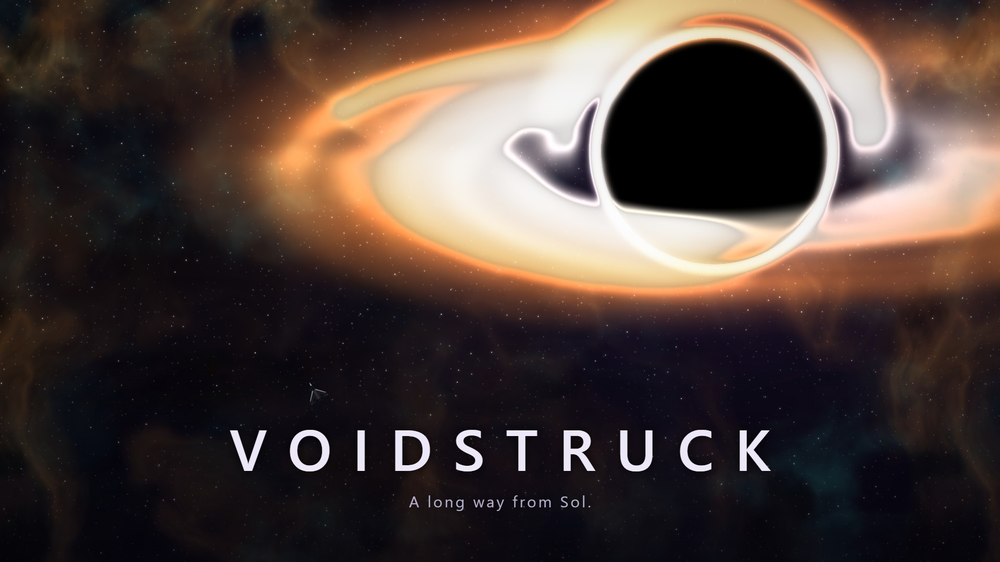
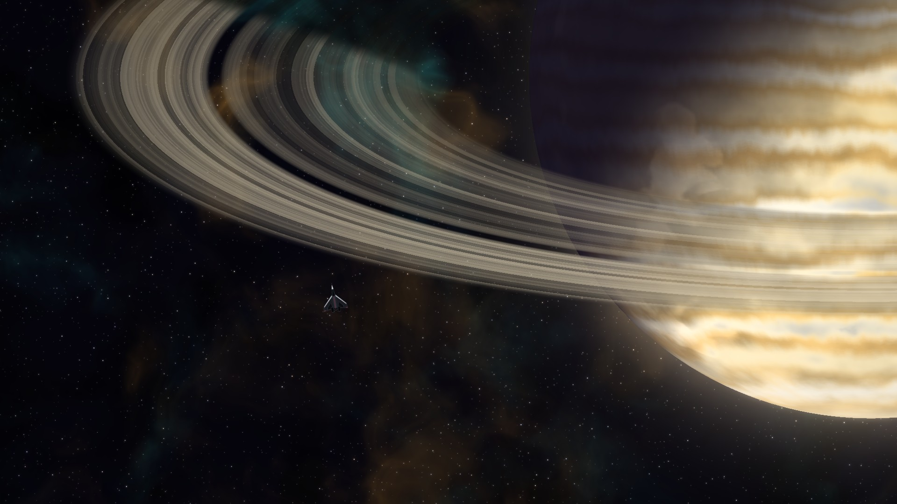
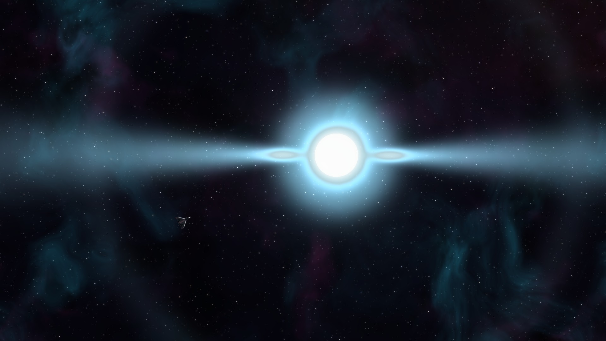
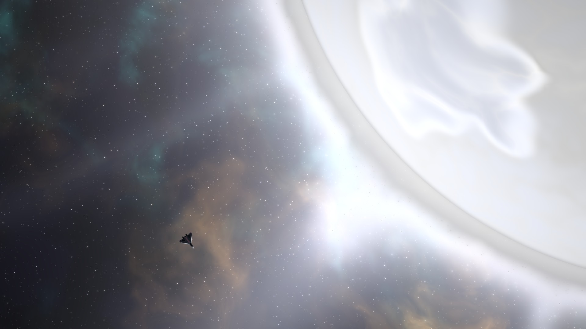
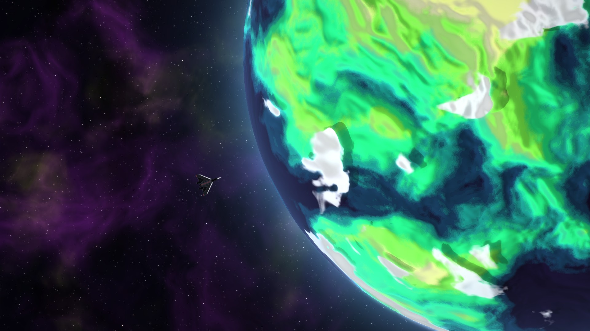
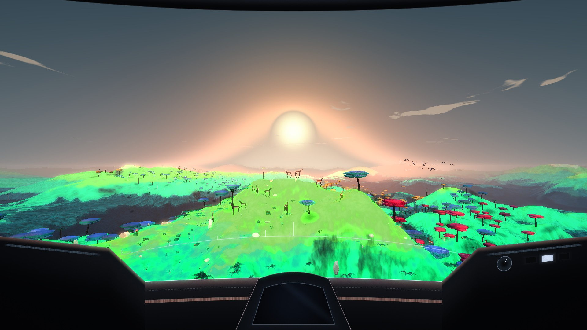
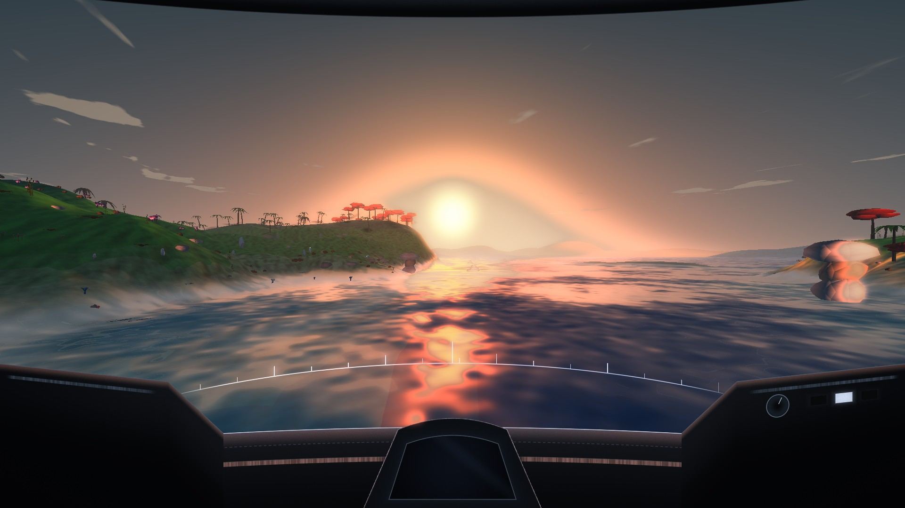
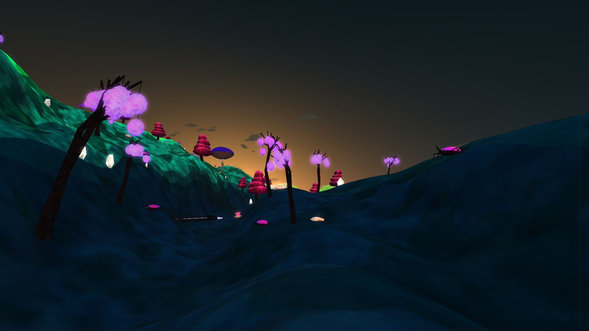
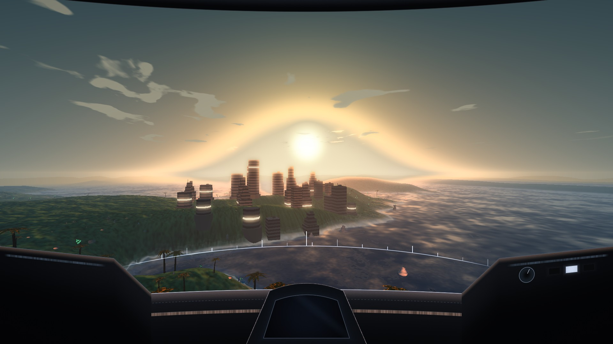

# Voidstruck

**A whole galaxy in one HTML file.** A space exploration game you fly, land on and walk, in 299 kB: no downloads, no installs, no images or sound files. Everything you see and hear is made by code as you play.

A test flight of a new jump drive goes wrong and throws you some 2,500 light years from home. The way back is one jump at a time, and every jump costs years on Earth. Then messages start to arrive.

https://github.com/user-attachments/assets/af506332-e2ef-4373-8d2d-085b77eb8bd4

## Play

**[Play Voidstruck in your browser](https://voidstruck.com/)**

Best in a current **Chrome** or **Edge** on a desktop computer, full screen (F11), with the sound on. It needs WebGPU, a mouse and a keyboard. Your journey is saved in the browser.

You can also download `index.html` and open it: the whole game is in that one file, and it works offline.

## Screenshots

| | |
|---|---|
|  |  |
|  |  |
|  |  |
|  |  |

Every picture is the game as it runs: nothing is drawn by hand.

## What is in it

- **A procedural galaxy.** Every star, planet, moon and name is worked out from a seed as you arrive. Yellow suns, red dwarfs, pulsars, white dwarfs and black holes, each with its own look and its own music.
- **Space flight.** Steer with the mouse, refuel in the glow of a star without burning up, cruise between worlds, and jump from system to system on a galaxy map.
- **Planets you can land on.** Fly down through the clouds of rocky, desert, ocean, ice, lava, toxic, crystal and living worlds, set the ship down, step out and walk. Plants, animals, weather, day and night.
- **Something to do there.** Scan worlds, mine deposits, build bases that earn while you travel, and trade at stations for a longer jump, a bigger tank, a tougher hull and more hold. Some systems hold raiders: fight, or run.
- **A story with three endings.** Messages from home catch up with you on the way, and three tasks (time shards kept by pulsars, black holes to measure, bases to leave behind) decide what you find when you land on Earth.
- **Sol as it is.** The planets in their real colours, and Earth with her continents and city lights.
- **A written soundtrack.** Ten pieces and every sound effect are synthesised in the browser.
- **Four ships** to choose from, and a hardcore mode with one life.

## How it was made

Voidstruck is one HTML file of 299 kB (about 114 kB compressed). It uses no game engine, no libraries and no asset files: there are no images, models or sound files to load, because there aren't any. Everything is computed while you play.

**No libraries at runtime.** The game talks to the browser directly: WebGPU for the picture, the Web Audio API for sound, plain HTML and CSS for menus and maps. The only tool in the project is esbuild, which bundles about 9,400 lines of JavaScript and WGSL shader code into the single file.

**The galaxy is a function, not data.** Every star is worked out from a seed and its coordinates, with an integer hash and a small random number generator (mulberry32). The disc is 14,400 light years in radius, cut into sectors of 4 light years, and nothing is stored: the same seed always gives the same stars, planets, moons and names.

**Space is drawn by shaders.** Stars, planets, rings, nebulae, the black hole and the jump tunnel are fragment shaders, not textures. Each planet's surface is baked once into a small map with a colour table when you arrive. A glow pass picks out the bright parts at quarter resolution, blurs them and adds them back.

**Planets are that same map, walked on.** Flying down, one full-screen pass marches each ray of sight over the planet's baked surface, so the ground you land on is the planet you saw from orbit. Close to the surface the ground becomes a real mesh of seven nested grids, each twice as coarse as the last, with shadows.

**Plants and animals are recipes.** A tree, a fern, a fungus or a spire is a family: a recipe with a handful of dials. Each planet rolls its own species from its seed, so no two worlds grow the same things, and the same world always grows the same ones. The cities of Earth are made the same way.

**All sound is synthesised.** There are two kinds of music. In space it is composed as it plays: each star system draws a key, a mode, a chord sequence and a short tune from its seed, and each kind of star has its own arrangement, so nothing loops. The ten written pieces are stored as text, melodies on a sixteenth-note grid (`E5:4` is E5 for four sixteenths) over chord symbols, and played by instruments built from oscillators: FM synthesis (one oscillator bending the pitch of another) for bells and electric pianos, detuned saw waves through filters for plucks and pads, and filtered noise for engines, fire and explosions. Even the reverb is synthetic: the room is a burst of generated noise that dies away.

**The rules are separate from the picture.** Flight, heat, fuel, jumps, trade, combat and the story are plain functions with no drawing in them, stepped at a fixed rate. That makes them testable outside the browser: 192 automated tests run through them, including whole journeys home.

**Staying small.** There was a budget of 300 kB from the start. The build strips the shaders of comments and spaces, shortens numbers (`1.0` becomes `1.`), and gives short names to long browser functions that are called hundreds of times. The title screen shows the file's real size.

**Who did what.** I didn't write the code. Claude wrote all of it in Claude Code, over about four days and 170 commits. My part was the idea, the story and the taste: I picked every look from mockups, sent the space stations back four times, and chose the music by ear from sketches, because the AI can't hear what it writes.

## Where the 299 kB go

Roughly, in the file as it ships:

| | |
|---|---|
| Drawing space: stars, planets, rings, the ship, the jump tunnel | 75 kB |
| Menus, maps, the flight display and every line of text | 60 kB |
| Planet surfaces: terrain, plants, animals, the cities of Earth | 50 kB |
| Music and sound: ten written pieces, the star music, every effect | 45 kB |
| The rules of the game and its story | 40 kB |
| Holding it together: input, saving, the main loop | 17 kB |
| Making the galaxy: stars, systems, planets and their names | 9 kB |

Sent compressed, as web servers do, the whole game is about 114 kB.

## Controls

The title screen lists every key. The short version: mouse to steer, `W` `S` to thrust and brake, `Shift` to boost, `C` cruise drive, `F` scan and dock, `M` galaxy map, `N` system map, `J` jump, `Q` your journey, `Esc` menu.

## Licence

Voidstruck is **free to play** and **source available**: you may play it here in the browser, download `index.html` to play offline, and read how it is made. It is not open source: you may not copy it to other sites, change it, republish it or sell it.

The terms are the [PolyForm Strict License 1.0.0](LICENSE). © 2026 Vitamax. The Voidstruck name and logo are not licensed. To ask for anything else, write to the address below.

## Contact

Made with passion by Vitamax, powered by Claude.

voidstruck.game@gmail.com

If you enjoy it, you can [help fund multiplayer](https://ko-fi.com/vitamax).
